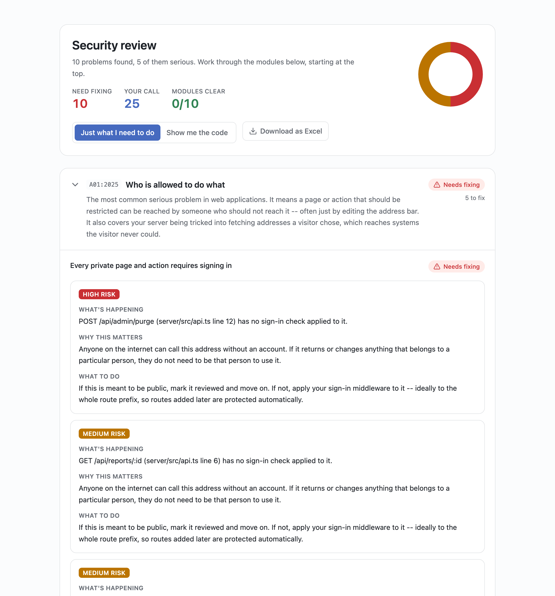

# ShipBrace

[](https://github.com/yalinGenc704/shipbrace/actions/workflows/ci.yml)

**A safety net for apps built with AI.** Paste a GitHub repository link, and
ShipBrace reviews the app's security: what is *proven* wrong, why it matters,
and what to do, in plain language. After that, every push is checked
automatically and the result appears right on the commit in GitHub.

<picture>
  <source media="(prefers-color-scheme: dark)" srcset="docs/images/report-dark.png">
  
</picture>

<sub>A ShipBrace report on a deliberately flawed sample app.</sub>

More and more people build web apps by describing what they want to an AI
coding assistant, without reading the code. ShipBrace is meant to sit next to
whichever assistant they use and take care of the parts that need an expert:
**security first**, then how the app is put together, then putting it online.

> **Status (October 2026):** the security review is built and **running live
> on Cloudflare** at [app.shipbrace.com](https://app.shipbrace.com) (invite-only
> while in development). Sign-in with GitHub, paste-a-link reviews, automatic
> reviews on every push, and private review history all work end to end.
> Deployment of users' apps is not started yet. See [Status](#status).

---

## How it works

```
 Developer / AI assistant ──push──▶ GitHub ──signed webhook──▶ Cloudflare Worker
                                                                   │  verify signature,
       app.shipbrace.com                                           │  queue the push
       sign in · paste a link ─────────────────────────────────▶  queue
       read reports                                                │
            ▲                                                      ▼
            │                                    fetch the commit from GitHub
            │                                                      │
            │                              ┌───────────────────────┴───────────┐
            │                              │ Reviewer container                │
            │                              │ internet switched off · no secrets│
            │                              │ one sealed process per review     │
            │                              └───────────────────────┬───────────┘
            │                                                      │
            └──────── D1 (review history, 90 days) ◀── result ─────┴──▶ GitHub check on the commit
```

1. **A push or a pasted link** starts a review. A pasted link only works for a
   repository the signed-in person can change, so ShipBrace cannot be used to
   map the weak spots of someone else's site.
2. **The code is fetched from GitHub** file by file and read, never run.
3. **The reviewer runs in a container with no internet access**, holding no
   secrets, inside which each review is a separate process with time and
   memory limits. Its only way out is one host the Worker answers itself.
4. **The result is posted as a GitHub check**, ❌ / ⚠️ / ✅ on the commit with
   notes on the exact lines, and kept for 90 days. Reports open only for
   people GitHub lets see the repository.

---

## The rule the review is built on

> **An AI may suggest where a problem might be. Only rules may decide that it is real.**

AI models are good at imagining where to look and bad at being certain: they
sound just as confident when they are wrong, and someone who cannot read code
cannot tell the difference. Rules are the opposite: given the same code they
always give the same answer, and can show how they got it. A rule can miss
things, but it does not make things up.

So the AI is a tipster and the rules are the fact-checkers. The review runs
fully **with no AI at all**; the optional AI step can only add findings the
rules then confirm.

```
1. Take stock      routes, every input a visitor controls, every dangerous operation     rules
2. Connect         follow each input through the code to a dangerous operation          rules
3. Pair up         try every input against every kind of operation                      rules
4. Ask (optional)  an AI suggests which records are private (invoices, messages)        AI
5. Verify          follow each suggestion through the code; only "proven" survives      rules
6. Report          sort into the OWASP Top 10 (2025) checklist
```

Steps 1–3 run before the AI is asked anything, so a repository written to
manipulate the model cannot use it to hide a real finding.

**An example.** Given

```js
const id = c.req.param("id");                         // a visitor controls this
db.query(`SELECT * FROM reports WHERE id = ${id}`);   // pasted into a database command
```

ShipBrace traces `id` from the request into the query with nothing checking it
on the way, and reports a **proven** high risk on that line. With the safe form
`` sql`... ${id}` `` it follows the same path, sees the protection, and reports
nothing.

### Every result means exactly one thing

| Result | Meaning |
| --- | --- |
| **Needs fixing** | A rule proved it: by tracing the path, or because it is the problem itself (a key written into the code). |
| **Worth a look, not proven** | Written in a risky way, but no visitor input was traced to it. Never counted as a risk. |
| **Your call** | No automatic check can decide it, or the check could not run here. Handed to the user with a plain question. |
| **Checked** | A check actually ran and found nothing, and the report says what it checked. Nothing passes just because no check exists. |

---

## The rules

All fixed checks, none using AI:

- **Following visitor input (the core).** Code is parsed into a syntax tree
  (oxc-parser), so code inside a string is never mistaken for real code.
  Values are followed from where a visitor controls them (address, body,
  headers, cookies, uploads, responses from other servers, outsider-controlled
  settings) into eight kinds of dangerous operation: SQL, MongoDB-style
  queries, system commands, file access, raw HTML, redirects, outbound
  requests, and code built at runtime. Validation, parameterised queries and
  escaping count as protection. Values are followed through helper functions
  across files. When unsure, the answer is "could not decide", never "safe".
- **Line-by-line checks.** Keys and tokens written into code (obvious
  placeholders excepted), committed `.env` files, secrets bundled into
  browser code, APIs open to every website, login tokens readable by page
  scripts or signed with a hard-coded key.
- **Whole-project checks.** Sign-in on every private route and role checks on
  admin pages, CSRF protection, slow password hashing and password hashes
  never sent back, expiring sessions, protective headers, error pages that
  don't leak internals, no public database port, rate limiting, no secrets in
  logs, pinned versions and a lockfile, and known flaws in dependencies
  (OSV.dev; only package names and versions are sent, and it can be switched
  off).

The checklist follows the **OWASP Top 10 (2025)**: 38 items, **22 checked
automatically** and 16 handed to the user with a question no rule can answer,
such as what personal data the app stores.

---

## Results, honestly

**Benchmark:** 56 sample apps with a known answer key: 31 real problems and
26 deliberately safe decoys built to look dangerous.

| | Real problems proven | False alarms |
| --- | --- | --- |
| Rules alone | 27 of 31 | 0 |
| With a perfect AI suggester | 30 of 31 | 0 |

With Claude as the suggester on the earlier 31-app version of the set, it
matched the perfect suggester exactly, with no false alarms; not yet re-run on
all 56. The one problem never found: a stored comment later rendered as raw
HTML. The scores are ratcheted by a test, so a change that loses one fails CI.

**Outside validation** on deliberately vulnerable practice apps (DVNA, OWASP
NodeGoat, OWASP Juice Shop): 5 of DVNA's 19 documented holes found
automatically. Not yet detected: XXE, some MongoDB-style injection, default
session secrets, and sign-in checks written inside a handler. The false alarms
these apps exposed were fixed and added to the benchmark.

**ShipBrace reviewing itself:** no proven vulnerabilities. It reports two
routes as open, and they are: catch-alls that only ever answer "not found",
which the checker cannot yet tell apart from a route that returns data (a
known gap). It also lists three "worth a look" notes on queries that build
`?` placeholders, with every value bound. Each false alarm it raised on its
own code along the way (fake keys in tests, a log message naming a setting,
requests to a fixed public API, webhook and sign-in routes) was fixed in the
checker itself, so users' apps no longer get them either.

The principle throughout: **missing a problem is a gap; inventing one is a
defect.** A warning about correct code teaches people to ignore the tool.

---

## Security of ShipBrace itself

Everything it reviews is someone else's code and is treated as hostile.

- **Reviewer isolation.** Internet switched off at the container level
  (proven on Cloudflare: web, raw-IP, socket and DNS attempts all fail), no
  secrets in its environment, and inside it Node's permission model per
  review (no network, no writes, reads limited to ShipBrace's own code) with
  work-time and memory limits. Replies from the reviewer are treated as
  untrusted: size-capped, shape-checked, each outside step at most once.
- **Sign-in.** GitHub App user authorization with a state check;
  `__Host-` cookies (HttpOnly, Secure, SameSite=Lax); only the SHA-256 of the
  session value is stored, and the user's GitHub token is AES-GCM encrypted.
  State changes require same-origin JSON.
- **Access.** Reviews start only on repositories the person can change, and
  open only for people GitHub lets see the repository, re-checked every few
  minutes. Uninstalling the App deletes its reviews.
- **What leaves the platform** is listed in
  [docs/legal/third-party-services.md](docs/legal/third-party-services.md),
  shown to users before their first review, and switchable per account.
- **Cost and abuse limits.** Per-person and daily review caps, capped
  container count; the AI step is off unless offered and switched on.
- **The browser.** A strict same-origin Content Security Policy; no
  third-party scripts.

---

## Repository layout

| Path | What it is |
| --- | --- |
| [`packages/guardrails`](packages/guardrails) | The review engine: parser wrapper, inventory, verifier, rules, checklist, OSV lookup, AI proposer, and the benchmark (`bench/`) |
| [`cloud`](cloud) | The hosted service on Cloudflare: Worker (webhook, queue job, API, sign-in), reviewer container, D1 history and migrations |
| [`server`](server) | Shared GitHub and review code, the sealed-process sandbox, and a Node server for running everything on one machine |
| [`app`](app) | The dashboard (React 19, TanStack Router and Query, Tailwind) |
| [`packages/scaffold`](packages/scaffold) | Generator for new apps' starting structure (not yet exposed to users) |
| [`deploy`](deploy) | Docker Compose setup for running on an ordinary server instead of Cloudflare |
| [`docs`](docs) | [Architecture decisions](docs/architecture.md) and the [data-handling notes](docs/legal/third-party-services.md) |

## Running it

Requires Node 26.

```bash
npm ci
npm test            # 207 tests; set TEST_DATABASE_URL to a PostgreSQL *_test database to include the history tests
npm run typecheck
npm run bench       # benchmark scores
npm run dev         # the dashboard on :5173 (sample data without a server)
```

Reviewing a folder on your own machine, with the dashboard:

```bash
npm run build
REVIEW_ROOT=/path/to/an/app node --experimental-strip-types server/src/index.ts
```

Deployment to Cloudflare is `npm run deploy` (Wrangler) after the one-time
setup described in [CLAUDE.md](CLAUDE.md), which also holds the full working
notes: conventions, current gaps and the roadmap.

**Built with:** TypeScript 7, Node 26, oxc-parser, Hono, React, Cloudflare
Workers, Containers, Queues and D1, PostgreSQL (single-machine mode), Docker.

---

## Status

| | |
| --- | --- |
| Security review engine, OWASP checklist, benchmark | ✅ |
| GitHub App: reviews every push, posts a check | ✅ live |
| Sign in with GitHub, paste a link, private review history | ✅ live |
| Sealed reviewer with no internet access | ✅ live, verified on Cloudflare |
| Notices before first use, per-account switches, 90-day retention | ✅ live |
| Privacy policy reviewed by a lawyer, public launch | ⏳ next |
| Starting structure for new apps | 🟡 built, not yet offered |
| Deploying users' apps | ❌ not started |
